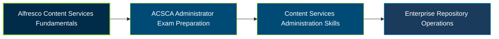

# Alfresco Content Services Certified Administrator Certification Exam Guide

A dedicated study guide and technical reference repository for candidates preparing for the **Alfresco Content Services Certified Administrator (ACSCA) Certification Exam**, covering repository administration, security, configuration, and operational maintenance.

---

## Exam Overview

The Alfresco Content Services Certified Administrator certification is associated with the administration of Alfresco Content Services, an enterprise content management platform. Hyland's 2026 catalog lists a current **Hyland Certified Alfresco Content Services Administrator Professional** certification; the ACSCA exam listing uses the earlier certification name.

  * **Exam Format**: Current exam delivery format is not specified in the publicly accessible certification information.
  * **Target Audience**: Alfresco system administrators, content platform administrators, and IT professionals responsible for repository operations.
  * **Prerequisites**: No publicly verified prerequisite for the ACSCA exam was located. Check the current Hyland certification listing for applicable requirements.

---

## Core Exam Domains & Knowledge Areas

The following study areas are mapped from Alfresco's administration documentation. They are not presented as an official published exam-domain blueprint.

### 1. Installation & Repository Configuration

  * Alfresco Content Services architecture and repository components.
  * Repository configuration, databases, subsystems, and content models.
  * Installation and deployment concepts, including container-based environments.

### 2. Repository Administration & Management Tools

  * Repository Admin Console, Share Admin Tools, and support tools.
  * Content stores, file and folder management, and repository maintenance.
  * Workflows, transformations, and metadata extraction.

### 3. Security, Users & Permissions

  * User and group administration and synchronization.
  * Authentication, authorization, roles, and permissions.
  * Auditing and security configuration for repository access.

### 4. Backup, Migration & High Availability

  * Repository backup and restore procedures.
  * Migration planning and content replication.
  * Clustering and high-availability administration concepts.

### 5. Monitoring & Troubleshooting

  * Repository health checks and administrative diagnostics.
  * Troubleshooting configuration, content, and service issues.
  * Reviewing logs and maintaining reliable Content Services operations.

---

## Certification Path

The following is a suggested learning progression, not an official Hyland prerequisite or certification pathway.

---

## Recommended Practice & Study Resources

Prepare with official Hyland learning materials, documentation-based study, and practical administration exercises:

  * **CertsGate**: Explore [Alfresco ACSCA certification preparation resources](https://certsgate.com/exams/alfresco/acsca) for supplementary study materials and practice questions.
  * **Alfresco Documentation**: Study the [Content Services documentation](https://docs.alfresco.com/content-services/community/) and practice repository administration, security management, backup, and troubleshooting.
